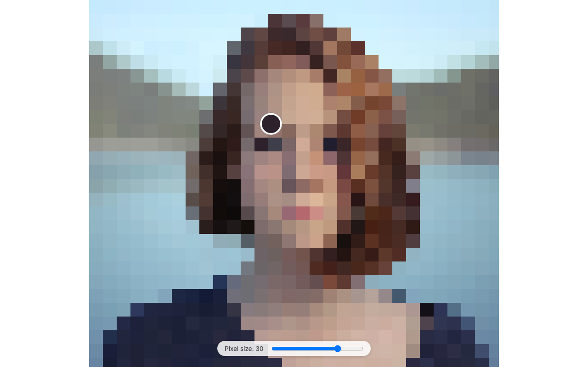

# Photo Pixelator

**A1G** · Interactive Media, UTS · 5–6 October 2026

A portrait rebuilt from blocks of colour. Slide to make the blocks finer or coarser, and move
the mouse over the photo to read the exact colour of the block underneath.

**▶ [Run it live](https://miyalee.github.io/p5-sketchbook/A1G_PhotoPixelator/)**


## Concept

How little of a picture do you need before you still recognise a face? At small block sizes
the portrait looks almost like the photo; push the slider up and it breaks into a handful of
flat tiles, yet the face is still there. The colour picker turns the same image into a
palette — every block is one colour you can point at.

## Inspiration

The Subsample and Downsample examples from class: sample one pixel from each cell of an
image and paint the whole cell in that colour.

## How it works

**`setup()`** — loads the photo with `await loadImage()` and calls `loadPixels()` once, so
every colour lookup afterwards is a direct read from the `pixels` array. It also builds the
slider and its label inside a `.slider-box` at the bottom of the screen.

**`drawPixelLayer()`** — fits the photo inside the window and centres it, then walks the
area in steps of `pixelSize` and fills each cell with one colour. The result is drawn onto
an off-screen `createGraphics()` layer, so the grid is only rebuilt when the slider moves,
not every frame.

**`colorAt(x, y)`** — finds which cell a screen point falls in, maps the centre of that cell
back to a pixel in the original photo, and returns its colour. The grid and the colour
picker both use it, so the picker always shows exactly the colour of the block under the
cursor.

**`draw()`** — draws the pixel layer, then, only while the mouse is over the photo, a
colour picker circle just above and to the right of the cursor, with a white outline and a
thin dark ring so it stays visible on any colour.

**Slider** — pixel size runs from 2 to 40. Moving it updates the label and rebuilds the
grid straight away.

## Pixel sizes

A1G has a single version with a live slider, so the variants are yours to make.

| Pixel size 12 | Pixel size 30 |
| --- | --- |
|  |  |
| Fine enough to read the face and the hair. | A few dozen tiles across, and the face is still there. |

## Run it

Serve the repo from its root, then pick this project:

```bash
npx http-server -p 8000
```

The photo is loaded from `assets/`, so opening `index.html` straight from disk won't work.

## Built with

p5.js 2.x (`js/p5.min.js`). Canvas fills the window.

Portrait photo (`assets/photo.png`) from [Unsplash](https://unsplash.com), used under the
[Unsplash License](https://unsplash.com/license).
