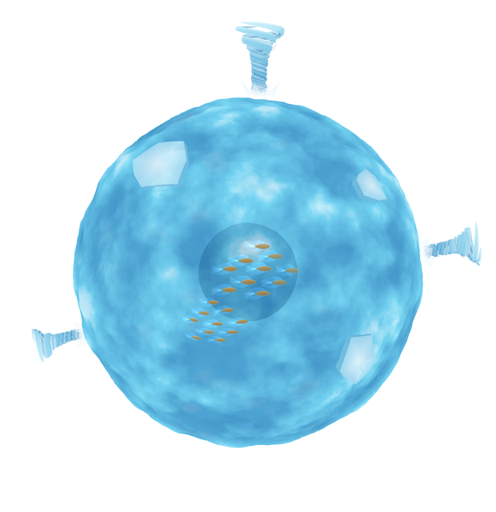
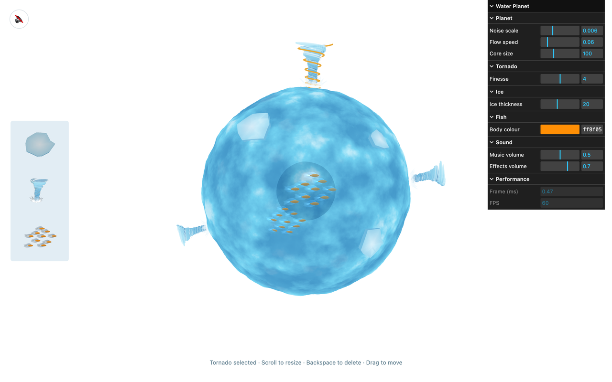

# Water Planet

**A2B** · Interactive Media, UTS · 23–27 October 2026

A planet made entirely of water, turning slowly in space. Drag ice floes, tornadoes and schools of fish onto it
from the palette on the left, then pick them up, move them, resize them or take them away.

**▶ [Run it live](https://miyalee.github.io/p5-sketchbook/A2B_WaterPlanet/)**



## Concept

Most generative landscapes are land: mountains, valleys, coastlines. Water Planet is a landscape with no ground
at all, a small world of water that you compose yourself.

The surface never stops moving, and the water is see-through, so a darker water core and the fish swimming round
it show through from inside. Everything you place rides the planet as it turns: ice floes bend to its curve,
tornadoes stand on the waves inside a crown of splashing water, and the fish glide sideways round the core.

## Inspiration

The *Generative Landscape* brief in *Code as Creative Medium* (Golan Levin and Tega Brain), and two of its
examples: *Lonely Planets*, a small pastel world under a night sky, and *Fractional Noise Mountains*, terrain
built from layers of noise. The colours come from ocean photos, the fish from a picture of glowing see-through
fish, and the first tornadoes from my own [A1F Tornado](../A1F_Tornado/).

## How it works

**`waterSurface()`** — the water is a p5.strands shader: written in JavaScript, turned into GLSL once, and run on
the graphics card. For every point of a 200 × 134 sphere it pushes the surface in or out with 3D noise that flows
over time; for every pixel it works out the colour again from the same noise, deep blue in the dips through aqua to
foam on the peaks, so the water stays sharp however close you zoom.

**`draw()`** — the see-through layers are drawn from the back to the front. Face culling splits the planet into
its far and near halves: far half, core, tornadoes and ice, then the near half without writing depth, so the fish
drawn after it glow through the water. The near half is drawn once more, depth only, so splashes on the far side
stay hidden behind the planet.

**`pickElement()`** — the pointer becomes a ray through the current camera, zoom and spin, so clicking works from
any angle. Fish schools are tested as a ball, ice floes by whether the point the ray hits on the ice lies inside
the floe's outline, and tornadoes as a stack of thin slices as wide as the funnel. Elements behind the planet or
the core can't be picked.

**`makeTornadoStrokes()`** and **`drawCrown()`** — a tornado is twenty open spiral strokes of wind, flat bands
that wind up a funnel, plus three white wisps. They spin and sway with noise, the bottom faster than the top. A
crown of water in three layers rises and falls round the base, the lower layers flatter and whiter.

**`makeIceGeometry()`** — each floe gets a random outline with seven to ten corners, drawn on a flat map round the
north pole and wrapped onto the sphere, half above the water and half below, so the waves sometimes wash over
its edges.

**`makeFishTexture()`** and **`makeFishBody()`** — the fins and tail are drawn once with canvas paths, gradients
and a soft glow, with a hole in the shape of the body. A 3D body built from the same Bézier curves fills the hole,
and a second shader waves the fins on the graphics card. The fish take on some of the water's colour, so they read
as being underneath it.

**`makeThumbnails()`** — the palette pictures are rendered once from the real models, so what you drag out looks
like what lands on the planet.

**Panel and sound.** A [lil-gui](https://lil-gui.georgealways.com/) panel changes the noise scale, the flow
speed, the size of the core, how sharply the tornadoes open up, the thickness of the ice, the colour of the fish
and the volumes. Picking up an element plays a short clip cut from a longer recording: a clink of ice, a gust of
wind, bubbling water. The button at the top left plays the background music.

## Interaction

- Drag an ice floe, a tornado or a school of fish from the palette onto the planet. Off the planet a picture
  follows the pointer; over it, the real model shows where it will land. Release outside the planet, or press
  Escape, to cancel.
- Click an element to select it: its outline turns gold. Drag it to move it along the surface.
- While an element is selected, scroll to resize it (0.4× to 2.5×), and press Backspace or Delete to remove it.
  Click the water or press Escape to deselect.
- Drag the empty water to orbit the camera, and scroll to zoom.

## Views

The planet is built by whoever is playing with it, so there are no fixed versions.

| The planet | The interface |
| --- | --- |
|  |  |

## Files

`sketch.js` holds `setup()`, which builds everything once, and `draw()`. The parts are in `src/`:

| File | What it does |
| --- | --- |
| `settings.js` | The settings the panel changes, and the panel |
| `space.js` | Spots on the planet, rays hitting balls, drawing one half of a ball, drawing without depth, colours |
| `water.js` | The planet and the core, and the p5.strands water shader |
| `tornado.js` | Tornadoes: the spiral strokes, the crown splash, clicking on them and their outline |
| `ice.js` | Ice floes: their shape and mesh, clicking on them and their outline |
| `fish.js` | Fish schools: the fin picture, the 3D body, the two shaders, swimming, clicking on them and their outline |
| `interaction.js` | The placed elements and what the pointer and the keyboard do with them |
| `palette.js` | The palette's pictures, and dragging new elements out of it |
| `sounds.js` | The background music and the sound effects |

## Run it

Serve the repo from its root, then pick this project:

```bash
npx http-server -p 8000
```

## Built with

p5.js 2.x (`js/p5.min.js`) in WEBGL mode, with p5.strands for the water shader, plus lil-gui 0.21
(`js/lil-gui.umd.min.js`) for the control panel. Canvas fills the window.
